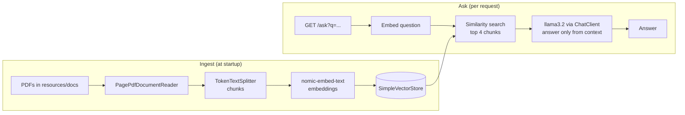

# RAG Demo: Grounded PDF Q&A with Spring AI and Ollama

A small Retrieval-Augmented Generation (RAG) service in Java. It reads PDF documents, indexes them as vector embeddings, and answers questions **using only what the documents say**. If the answer isn't in the documents, it replies "I don't know" instead of guessing.

Everything runs locally: no cloud API keys and no data leaves the machine.

## How it works



1. **Ingest:** each PDF is read page by page and split into token-sized chunks.
2. **Embed:** each chunk becomes a vector using `nomic-embed-text`, stored in an in-memory vector store.
3. **Retrieve:** the question is embedded and the 4 most similar chunks are found.
4. **Generate:** `llama3.2` answers with those chunks as its only context.
5. **Guardrail:** the system prompt tells the model to answer only from the context, or say "I don't know".

## Why RAG instead of asking the model directly

- The model was never trained on private or recent documents. RAG supplies them at question time, with no retraining.
- Answers are grounded in known chunks, so they can be traced back to a source, which matters for auditability.
- It reduces hallucination: questions outside the documents get "I don't know".

## Tech stack

- Java 21, Spring Boot 4, Spring AI
- Ollama (local models): `llama3.2` for chat, `nomic-embed-text` for embeddings
- Spring AI `SimpleVectorStore` (in-memory)
- Gradle

## Run it locally

Prerequisites: JDK 21 and [Ollama](https://ollama.com).

```bash
ollama pull llama3.2
ollama pull nomic-embed-text
```

1. Put one or more PDFs in `src/main/resources/docs/` (PDFs are git-ignored).
2. Start the app:
   ```bash
   ./gradlew bootRun        # Windows: .\gradlew.bat bootRun
   ```
3. Wait for `Ingested <file>.pdf: N chunks` in the log.
4. Ask a question:
   ```
   http://localhost:8080/ask?q=What is this document about?
   ```

Try a question the documents don't cover. It should answer "I don't know".

## Design choices

- **Local models:** no API costs and no data leaving the machine; easy to swap for a hosted model (for example Amazon Bedrock) through Spring AI configuration.
- **In-memory vector store:** simplest option for a demo; re-indexes on every start.
- **Prompt-level guardrail:** a simple, visible first line of defence against hallucination.

## Roadmap

- [ ] **Evals:** a small set of questions with expected answers, run automatically to measure answer quality and catch regressions
- [ ] **Source citations:** return the document and page each answer came from
- [ ] **Persistent vector store** (for example PostgreSQL with pgvector) so documents aren't re-indexed on every start
- [ ] **Hosted model option** (Amazon Bedrock) via configuration
